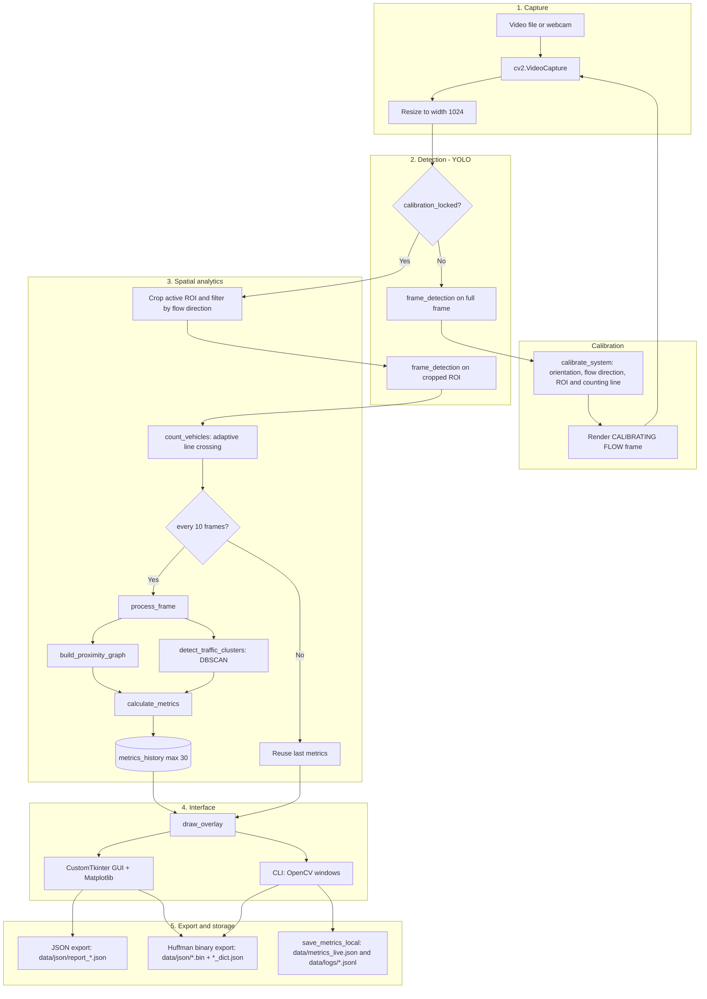

# Roadwork Vehicle Traffic Monitoring System

A computer-vision desktop application for monitoring vehicular traffic in
roadworks and temporary work zones. It detects and tracks vehicles with
Ultralytics YOLO, counts line crossings, clusters vehicle positions with DBSCAN
to detect congestion, and exports compact telemetry using a custom Huffman
binary codec. Two interfaces are provided: a CustomTkinter desktop monitor and
an OpenCV CLI viewer.

> Scope note: this document describes only what is implemented in this
> repository. No accuracy, throughput or compression benchmarks are claimed.

---

## Overview

The system runs a continuous frame loop: it captures video (file or webcam),
runs YOLO detection/tracking, counts vehicles crossing an automatically placed
virtual line, and periodically computes traffic metrics (flow per minute,
spatial interaction, congestion risk). Results are drawn over the video and on a
dashboard, and can be exported as JSON or as Huffman-compressed binary reports.

---

## Quick Start (no Python knowledge required)

The repository includes one-command launchers that create an isolated
environment, install dependencies and start the application.

**Windows** — double-click `run.bat`, or run it from a terminal:

```bat
run.bat            REM live CLI (opens two OpenCV windows)
run.bat gui        REM CustomTkinter desktop app
run.bat demo       REM writes an annotated demo video, no windows
run.bat test       REM runs the unit tests
```

**Linux / macOS**:

```bash
./run.sh           # live CLI
./run.sh gui       # desktop GUI
./run.sh demo      # annotated demo video
./run.sh test      # unit tests
```

The first run creates a `.venv/` folder and installs dependencies from
`requirements-portable.txt` (unpinned, compatible with any Python 3.9+). Later
runs start immediately. `requirements.txt` keeps the exact pins used by Docker
and CI.

Press `Q` in the video window to stop the CLI.

---

## Demo

`scripts/demo.py` runs the real pipeline headlessly and writes an annotated MP4
plus a JSON summary. It does not open windows, so it also works over SSH, in a
container or on a machine without a display — useful for sharing results.

```bash
python -m scripts.demo
# or with the launcher:
./run.sh demo
```

By default it processes up to 450 frames of `data/videos/trafico1.mp4` and
writes:

| File | Content |
|---|---|
| `demo/demo_trafico1.mp4` | Annotated video: detections, IDs, cluster labels, counting line |
| `demo/demo_summary.json` | Calibration result, crossings and final metrics |
| `demo/dashboard.png` | Last dashboard frame |

Flags:

```bash
# Process another video, fewer frames, smaller output
python -m scripts.demo --video data/videos/trafico2.mp4 --max-frames 300 --scale 0.8

# Process the whole video
python -m scripts.demo --max-frames 0
```

Generated demo files are excluded from version control (see `.gitignore`).

---

## Problem It Solves

Roadworks and temporary work zones change traffic flow and create bottlenecks.
This project provides a self-contained, local way to:

- **Detect and count vehicles** along an adaptive virtual counting line. The
  calibration step infers whether traffic flows up/down (vertical) or
  left/right (horizontal) and which way is dominant, then counts crossings in
  that direction.
- **Detect congestion with spatial clustering**: vehicle centroids are grouped
  with DBSCAN, and each group is classified as low, medium or high risk based
  on size and flow rate.
- **Summarize the road state**: vehicles in scene, flow per minute, spatial
  interaction percentage, flow level/state and trend.
- **Export compact binary telemetry**: JSON reports are compressed with a custom
  Huffman codec into a `.bin` payload plus a dictionary sidecar, which is useful
  for constrained links.

> **Counting semantics:** counting is directional. Calibration determines a
> single dominant flow direction per run, and vehicles moving in the opposite
> direction are ignored by `count_vehicles`. The system does **not** count both
> directions simultaneously.

---

## Key Capabilities

- **Vehicle detection and tracking** with an Ultralytics YOLO model
  (`persist=True`, COCO vehicle classes `1, 2, 3, 5, 6, 7`).
- **Automatic calibration** over the first 30 frames: infers the dominant flow
  orientation/direction and builds an adaptive ROI and counting line.
- **Directional line-crossing count** with a set of already-counted IDs to avoid
  double counting.
- **Spatial analysis**: a proximity graph over vehicle centroids plus DBSCAN
  clustering to identify groups of close vehicles.
- **Traffic metrics**: vehicles in scene, flow per minute (from real crossing
  timestamps), spatial interaction percentage, flow level/state, trend,
  per-cluster risk and a congestion alert.
- **Visualization**: a video overlay (counting line, per-vehicle HUD, cluster
  labels) plus a dashboard, and a CustomTkinter GUI with a live Matplotlib chart.
- **JSON export** for a snapshot or the accumulated history.
- **Custom Huffman compression** of JSON reports into a `.bin` file plus a
  dictionary sidecar, with in-app decompression.
- **Local persistence** of a live metrics file and a daily JSONL history (CLI).
- **Environment-based configuration**, Docker packaging and a GitHub Actions CI
  pipeline.

---

## Architecture



Both entry points share the same core: `src/pipeline/pipeline.py` orchestrates
the proximity graph, DBSCAN clustering and metric calculation, while
`src/detection/detection.py` is the only place that runs YOLO.

---

## Tech Stack

| Component | Version | Role |
|---|---|---|
| Python | 3.11 (Docker/CI) | Runtime |
| Ultralytics | 8.1.0 | YOLO detection and tracking |
| OpenCV (`opencv-python`) | 4.9.0.80 | Video I/O, drawing, CLI windows |
| NumPy | 1.26.4 | Array and vector math |
| scikit-learn | 1.4.1.post1 | DBSCAN clustering |
| CustomTkinter | 5.2.2 | Desktop GUI |
| Matplotlib | 3.8.3 | Live flow chart in the GUI |
| Pillow | 10.2.0 | Frame conversion for Tkinter |
| python-dotenv | 1.0.1 | Load `.env` configuration |
| flake8 | 7.1.1 | Linting (dev/CI) |
| pytest | 8.3.3 | Unit tests (dev/CI) |

Huffman coding is implemented in-house with the standard library (`heapq`,
`collections.Counter`); no third-party compression library is used.

---

## Project Structure

```
.
├── src/
│   ├── app.py                  # GUI entry point
│   ├── main.py                 # CLI entry point (OpenCV windows)
│   ├── config.py               # env-driven configuration
│   ├── gui.py                  # CustomTkinter UI + VehicleCounterEngine
│   ├── __init__.py
│   ├── __main__.py             # enables: python -m src
│   ├── analytics/
│   │   ├── clustering.py       # DBSCAN clustering
│   │   ├── graphs.py           # proximity graph
│   │   ├── huffman.py          # Huffman compress/decompress
│   │   ├── metrics.py          # traffic metric calculations
│   │   └── processing.py       # state, calibration, counting, Huffman export
│   ├── detection/
│   │   └── detection.py        # YOLO model + frame detection
│   ├── pipeline/
│   │   └── pipeline.py         # per-frame orchestration
│   ├── storage/
│   │   └── json_writer.py      # live snapshot, JSONL and JSON export
│   └── visualization/
│       └── overlay.py          # video overlay + dashboard
├── scripts/
│   └── demo.py                 # headless demo video generator
├── tests/
│   ├── test_huffman.py
│   ├── test_metrics.py
│   └── test_graphs.py
├── data/
│   ├── videos/                 # sample input videos
│   ├── json/                   # exported reports (generated)
│   └── logs/                   # daily JSONL history (generated)
├── models/
│   └── yolo26n.pt              # YOLO weights (expected at this path)
├── docs/
│   └── ARCHITECTURE.md
├── run.bat                     # Windows one-click launcher
├── run.sh                      # Linux / macOS launcher
├── Dockerfile
├── .dockerignore
├── .env.example
├── .flake8
├── pytest.ini
├── requirements.txt
├── requirements-portable.txt
├── requirements-dev.txt
└── .github/workflows/ci.yml
```

---

## Installation

### Prerequisites

- Python 3.9+ (3.11 is the version used by Docker and CI; newer versions work
  through `requirements-portable.txt`).
- A video file (sample clips are in `data/videos/`) or a webcam.
- Optional: Docker, for the container workflow.

### Local Setup

> If you just want to run the project, use the [Quick Start](#quick-start-no-python-knowledge-required)
> launchers instead. The steps below describe the manual setup.

```bash
# 1. Clone the repository
git clone <your-repository-url>
cd sistema-aforo-vehicular-obras-viales

# 2. Create and activate a virtual environment
python -m venv venv
# Windows (PowerShell):
venv\Scripts\Activate.ps1
# Linux / macOS:
source venv/bin/activate

# 3. Install runtime dependencies
pip install -r requirements.txt

# 4. Create your local environment file
# Windows:
copy .env.example .env
# Linux / macOS:
cp .env.example .env
```

The YOLO weights are expected at `models/yolo26n.pt`; this path is configurable
through `YOLO_MODEL_PATH`. If the file is missing, Ultralytics attempts to
download it on first use.

### Configuration

Configuration is read from environment variables, optionally loaded from a
local `.env` file at the project root.

| Variable | Default | Purpose |
|---|---|---|
| `DEFAULT_VIDEO_PATH` | `data/videos/trafico1.mp4` | Video processed on startup |
| `YOLO_MODEL_PATH` | `models/yolo26n.pt` | YOLO weights file |
| `LIVE_FRAME_PATH` | `data/live_frame.jpg` | Frame snapshot written by the CLI |

Relative paths are resolved against the project root, so they work regardless
of the current working directory.

---

## Running the Application

### GUI (CustomTkinter)

```bash
python -m src.app
# or, equivalently:
python -m src
```

The GUI lets you start/pause processing, load another video, enable automatic
console logging at an interval, export JSON (snapshot or history), export
Huffman-compressed reports, and decompress a `.bin` report using its dictionary.

### CLI (OpenCV)

```bash
# Process the default video
python -m src.main

# Process a specific video file
python -m src.main --video data/videos/trafico2.mp4

# Use the webcam (channel 0)
python -m src.main --webcam
```

CLI keyboard controls:

- `Q` – quit.
- `E` – export a Huffman-compressed report for the current metrics.

### Demo video (headless)

```bash
python -m scripts.demo
```

Runs the same pipeline without opening windows and writes the annotated video
and a JSON summary to `demo/`. See [Demo](#demo) for details and flags.

---

## Docker

The image is based on `python:3.11-slim` and installs the native libraries
needed by OpenCV and PyTorch (`libgl1`, `libglib2.0-0`, `libgomp1`, and X11
libraries). The default command runs the CLI pipeline.

### Build and Verify

```powershell
# Build the image (the first build downloads PyTorch and takes a while)
docker build -t vehicle-counter .

# Headless check: imports, model load and argument parsing
docker run --rm vehicle-counter python -m src.main --help

# Verify the native dependencies resolve
docker run --rm vehicle-counter python -c "import cv2, numpy, sklearn, ultralytics; print('deps OK', cv2.__version__)"

# Open a shell inside the container
docker run --rm -it vehicle-counter bash
```

### Running with a Display

OpenCV opens native windows, so a display is required to *see* the output.

- **Linux / WSL2:**

  ```bash
  docker run --rm -e DISPLAY=$DISPLAY -v /tmp/.X11-unix:/tmp/.X11-unix vehicle-counter
  ```

- **Windows (optional, requires an X server such as VcXsrv/X410):**

  ```powershell
  docker run --rm -e DISPLAY=host.docker.internal:0.0 vehicle-counter
  ```

> The container targets the CLI pipeline (`src.main`). The CustomTkinter GUI
> (`src.app`) additionally requires Tkinter, which is not part of the slim base
> image; running the GUI in Docker would need a base image that includes
> Tkinter.

---

## Testing and Linting

```bash
# Install development dependencies (runtime + flake8 + pytest)
pip install -r requirements-dev.txt

# Run the unit tests
pytest -q

# Lint the source tree
flake8 src
```

The test suite covers pure, side-effect-free logic: the Huffman
compress/decompress round trip, the metrics output schema, and the proximity
graph/clustering helpers. Tests do not load the YOLO model or open windows.

---

## Continuous Integration

`.github/workflows/ci.yml` runs on every push to `main` and on pull requests
targeting `main`. It checks out the repository, sets up Python 3.11 with pip
caching, installs the Linux libraries required by OpenCV/PyTorch, installs
`requirements-dev.txt`, runs flake8 (a blocking pass for syntax/undefined-name
errors plus a non-blocking style report) and runs `pytest -q`.

---

## Data Outputs

| Path | Producer | Content |
|---|---|---|
| `data/metrics_live.json` | CLI (`save_metrics_local`) | Latest metrics snapshot, overwritten |
| `data/logs/metrics_YYYY-MM-DD.jsonl` | CLI (every 150 frames) | Appended daily history |
| `data/live_frame.jpg` | CLI | Latest annotated frame |
| `data/json/report_snapshot_*.json` | GUI export | Single-point metrics report |
| `data/json/report_history_*.json` | GUI export | Accumulated history report |
| `data/json/huffman_snapshot_*.bin` + `_dict.json` | GUI/CLI | Huffman-compressed snapshot |
| `data/json/huffman_history_*.bin` + `_dict.json` | GUI | Huffman-compressed history |

Generated outputs, model weights and local `.env` files are excluded from
version control (see `.gitignore`).

---

## Limitations

- Counting is **directional**: one dominant flow direction is inferred during
  calibration, and opposite-direction vehicles are ignored. It is not
  simultaneous two-way counting.
- The repository does not include performance or accuracy benchmarks.
- The Docker image targets the CLI pipeline; the GUI needs Tkinter plus a
  display.
- Model weights and generated data are not versioned; keep them locally or
  mount them when running the container.

---

## License

No license file is included in this repository.
